# EcoPulse 🌱⚡

> **Hyper-Local Carbon Footprint Tracker & PM Surya Ghar Solar Rooftop Platform**  
> **HackCult '26 | Track HC26-GEDA01 (Gujarat Energy Development Agency)**  
> **Team:** [TEAM_NAME] | **Members:** [MEMBERS]  
> **Repository:** [REPO_URL] | **Live Web Demo:** [DEMO_URL] | **Video Pitch:** [VIDEO_URL]

---

## 📹 Video Walkthrough & Pitch

> [!IMPORTANT]
> **Video Requirement for HackCult '26 Evaluation:**  
> A 2 to 3 minute video walkthrough is required for track HC26-GEDA01. Use the accompanying speaker notes in [`docs/deck/speaker-notes.md`](file:///d:/Sem5/HackCult-26/docs/deck/speaker-notes.md) for recording.
>
> **Video Demo Link:** `[VIDEO_DEMO_LINK: YouTube / Loom unlisted URL of 2-3 minute mobile app walkthrough & architecture pitch]`

---

## 🎯 Executive Summary & Problem Solved

Across urban and semi-urban India, a critical gap exists between **climate awareness** and **daily citizen habits**:
1. **Intangible Footprints:** Citizens do not know how their monthly domestic electricity units, LPG cylinder usage, and daily commutes translate into kilograms of greenhouse gas emissions.
2. **Generic Advice:** National climate tips lack hyper-local context (e.g., Gujarat-specific grid emission factors, local DISCOM tariffs, and district-level solar insolation).
3. **Friction in Renewable Adoption:** PM Surya Ghar: Muft Bijli Yojana offers up to ₹78,000 in central subsidies, yet homeowners struggle with complex rooftop area calculations, DISCOM net-metering rules, and finding verified local vendors.

**EcoPulse** closes this gap through a mobile-first, tri-lingual application that pairs **authoritative emission accounting** (CEA v19 & IPCC standards) with **gamified behavioral nudges**, a **deterministic PM Surya Ghar solar rooftop hub**, and **neighborhood-level community leaderboards**.

---

## ✨ Key Capabilities

| Capability | Status | Description |
| :--- | :---: | :--- |
| **Dual-Mode Footprint Tracker** | **Built** | Supports both Household (shared domestic bills) and Individual (students, PG, single-living) profiles with live deterministic preview during onboarding. |
| **Lifestyle Nudges & Daily Check-ins** | **Built** | 13 official sustainable lifestyle tasks across Energy, Transport, Waste, and Water with multi-day cycle tracking and anti-cheat validation. |
| **PM Surya Ghar Solar Hub** | **Built** | Interactive rooftop calculator featuring **EcoMascot** with step-specific poses, preferring kWh unit precision, roof constraints, optional orientation derating, and subsidy toggles. |
| **Empanelled Vendor Connect** | **Built** | Direct lead routing to verified solar EPC vendors in Gandhinagar, Ahmedabad, Surat, and Vadodara with one-tap Call and WhatsApp actions. |
| **Multi-Scope Leaderboards** | **Built** | Area, District, and State leaderboards featuring gold/silver/bronze podiums, streak badges, and "Your Standing" progress nudges. |
| **Tri-Lingual Engine (EN / GU / HI)** | **Built** | Seamless on-the-fly language switching across English, Gujarati (ગુજરાતી), and Hindi (हिन्दी) via React Context. |
| **Authoritative Deterministic Engine** | **Built** | Pure mathematical engine shared identically between Expo client live-preview and Express backend verification. |
| **GEDA Administrative Aggregation** | **Planned** | Macro district-level carbon abatement dashboards and anonymized solar adoption heatmaps (Roadmap Phase 2). |

---

## 📱 Application Screenshots & User Interface

```
+----------------------------------------------------------------------------------------------------+
|                                    APP WALKTHROUGH SCREENS                                         |
+-------------------+--------------------+--------------------+--------------------+-----------------+
|   1. ONBOARDING   |      2. HOME       |   3. ACTIVITIES    |      4. SOLAR      |   5. VENDORS    |
|   Baseline Setup  |   Impact Snapshot  |   Habit Tracker    |   PM Surya Ghar    | Empanelled EPCs |
+-------------------+--------------------+--------------------+--------------------+-----------------+
```

> [!NOTE]
> Viewport captures are sized for mobile-first presentation (390 × 844 px, iPhone 14 / modern Android standard). High-resolution captures are stored in [`docs/deck/assets/`](file:///d:/Sem5/HackCult-26/docs/deck/assets/).

### 1. Dual-Mode Onboarding & Emission Estimation
`[SCREENSHOT_PLACEHOLDER: docs/deck/assets/screen_onboarding.png - StepHome district selection and live monthly CO2 estimation gauge]`
* **Description:** Citizens enter their district (resolving to GERC DISCOM tariffs), dwelling type, electricity units, and transport. The floating badge provides live estimation (`~128 kg CO₂/mo`) without requiring network roundtrips.

### 2. Home Impact Dashboard
`[SCREENSHOT_PLACEHOLDER: docs/deck/assets/screen_home.png - EcoPulse Home Dashboard with Brand Teal-Mint curved header, 32% CO2 avoided hero card, snapshot metrics, and smart suggestions]`
* **Description:** Displays monthly CO₂ emissions, avoided kilograms, current streak, EcoScore categories, and daily quick-win suggestions.

### 3. Habit Challenges & Daily Check-ins
`[SCREENSHOT_PLACEHOLDER: docs/deck/assets/screen_activity.png - Sustainable lifestyle habit screen showing daily check-in counter, anti-cheat validation, and Green Points reward]`
* **Description:** Citizens commit to 3-day to 7-day micro-habits (LED adoption, public transit, dry waste segregation). Multi-day check-ins enforce single-submission-per-day rules.

### 4. Solar Rooftop Calculator (EcoMascot Flow)
`[SCREENSHOT_PLACEHOLDER: docs/deck/assets/screen_solar.png - Solar Rooftop Calculator with EcoMascot character in celebratory pose, 4 metric grid cards, and lifetime savings highlight]`
* **Description:** Interactive rooftop assessment using unit-first input (kWh), roof area constraints, PM Surya Ghar subsidy slabs (up to ₹78,000), and collateral-free loan indicators (<6% interest).

### 5. Verified Local Vendor Connect
`[SCREENSHOT_PLACEHOLDER: docs/deck/assets/screen_vendors.png - Verified partner list for Gandhinagar / Ahmedabad with 4.9+ star ratings, Call now and WhatsApp Us buttons]`
* **Description:** Connects citizens directly to empanelled solar EPC contractors with pre-filled WhatsApp enquiry messages.

---

## 🏛️ System Architecture

EcoPulse employs an **offline-first, client-authoritative preview with server-enforced verification** architecture.


### End-to-End Request Flow
```
1. Citizen Input (Client UI)
   │  ↳ User enters monthly kWh and roof area in React Native client
   ▼
2. Client Deterministic Preview (shared/engine/solar.js)
   │  ↳ Immediate zero-latency ROI calculation rendered via mirrored engine
   ▼
3. Authenticated API Call (REST POST /api/v1/solar/calculate)
   │  ↳ Express server receives payload with JWT bearer token
   ▼
4. Authoritative Server Re-computation (server/controllers/solarController.js)
   │  ↳ Server recalculates using shared/engine to prevent tampering
   ▼
5. Database Persistence (MongoDB Atlas)
   │  ↳ SolarEstimate document created with user ID and timestamp
   ▼
6. Aggregated Response & Next Steps
      ↳ Client displays verified estimate & unlocks local empanelled vendors
```

---

## 🔬 Scientific Calculation Standards & Engine Verification

All emission factors and solar metrics are driven by configuration files in [`shared/engine/config/`](file:///d:/Sem5/HackCult-26/shared/engine/config/):

| Parameter | Value | Source / Methodology | Verification Status |
| :--- | :---: | :--- | :---: |
| **Indian Grid Emission Factor** | `0.716 kg CO₂/kWh` | Central Electricity Authority (CEA) CO₂ Baseline Database v19 (2024) | **Verified** |
| **Domestic LPG Emissions** | `2.983 kg CO₂/kg` | IPCC 2006 Guidelines for National GHG Inventories | **Verified** |
| **Two-Wheeler Petrol** | `0.045 kg CO₂/km` | India ARAI / MoEFCC Transport Standards | **Verified** |
| **Four-Wheeler Petrol/Diesel** | `0.142 kg CO₂/km` | India ARAI Benchmark for Mid-size Sedan | **Verified** |
| **PM Surya Ghar Subsidy (0–2 kW)** | `₹30,000 / kW` | Ministry of New & Renewable Energy (MNRE), Feb 2024 | **Verified** |
| **PM Surya Ghar Subsidy (3 kW+)** | `₹78,000 max` | MNRE PM Surya Ghar National Portal Guidelines | **Verified** |
| **Gujarat Residential Tariffs** | Slabs ₹3.20 to ₹5.30 | GERC Tariff Orders (UGVCL, PGVCL, DGVCL, MGVCL, Torrent Power) | **Verified** |
| **Annual District Solar Yield** | 1,450 – 1,620 kWh/kWp | European Commission PVGIS satellite solar radiation dataset (33 districts) | **Verified** |
| **State Top-up Subsidy** | Optional / ₹0 | GEDA policy alignment placeholder | *Pending GEDA formal confirmation* |
| **Vendor EPC Capex** | ~₹50,000 / kW | Market benchmarks | *Pending formal GEDA discovery rate* |

> **Automated Engine Verification:**  
> The engine is guarded by **24 automated deterministic unit tests** (`npm test`) that check subsidy tiers, tariff inversions, degradation over 25 years, and engine file synchronization.

---

## 🗄️ Database Schema & Integrity



### Data Integrity Principles:
1. **Append-Only Green Points Ledger (`GreenPointTransaction`):**  
   Points can never be updated or deleted in place. Every action or challenge completion generates a discrete transaction record with a unique `transactionType` and timestamp. The user's total points represent a deterministic summation of the ledger.
2. **Immutable Baseline Snapshot (`User.household` & `User.baselineAnnualCO2Kg`):**  
   The onboarding snapshot is frozen upon completion, serving as an immutable reference datum to calculate longitudinal emission savings across months.
3. **Anti-Cheat Multi-Day Check-in Cycles (`UserActivityCycle` & `ActivityCheckIn`):**  
   Compound database index `{ userId: 1, cycleId: 1, checkInDate: 1 }` with a unique constraint prevents multiple check-ins within the same calendar day.

---

## 💻 Tech Stack

| Layer | Technology | Version | Purpose in EcoPulse |
| :--- | :--- | :---: | :--- |
| **Mobile Client** | React Native / Expo | `51.0.0` | Cross-platform iOS, Android & Responsive Web export. |
| **Client State** | TanStack Query | `5.0.0` | Cached network fetching, optimistic updates, and offline sync. |
| **Backend API** | Node.js / Express | `4.19.2` | RESTful API, rate-limiting middleware, and centralized error handling. |
| **Database** | MongoDB Atlas / Mongoose | `8.0.0` | Flexible NoSQL document database with compound multi-scope indexes. |
| **Auth & Security** | JWT & Bcrypt.js | `9.0.2` | Stateless bearer token authentication and salted password hashing. |
| **Calculation Engine**| Pure JavaScript (CommonJS) | ES6+ | Zero-dependency, deterministic engine shared by client and server. |
| **Testing** | Node Test Runner / Assert | Built-in | Fast, dependency-free deterministic unit test execution. |
| **Deck & Docs** | Marp CLI & Mermaid | Latest | 16:9 PDF pitch deck export and SVG architecture rendering. |

---

## 🚀 Getting Started & Installation

### Prerequisites
- **Node.js** >= 18.x
- **npm** >= 9.x
- **Git**
- **Expo Go** app (optional, for physical iOS/Android testing)

### 1. Clone the Repository
```bash
git clone [REPO_URL]
cd HackCult-26
```

### 2. Backend Setup
```bash
cd server
npm install
cp .env.example .env
```
*Configure your `.env` file:*
```env
PORT=5000
NODE_ENV=development
MONGODB_URI=mongodb+srv://<username>:<password>@cluster0.xxxx.mongodb.net/ecopulse?retryWrites=true&w=majority
JWT_SECRET=your_super_secret_jwt_key_here
JWT_EXPIRE=30d
```

*Seed activities and initial Gujarat community leaderboards:*
```bash
node scripts/seedActivities.js
node scripts/seedLeaderboard.js
cd ..
```

### 3. Client Setup
```bash
cd client
npm install
cd ..
```

### 4. Run the Full Application
Start the backend server:
```bash
cd server
npm run dev
```
In a separate terminal, start the Expo mobile client:
```bash
cd client
npx expo start
```
*Press `w` in the Expo terminal to open the web dashboard preview, or scan the QR code with Expo Go on your mobile phone.*

---

## 🧪 Testing & Verification

Run the engine synchronization check and the 24 verification test suites:
```bash
npm test
```
*Output:*
```
✓ config.json is in sync.
✓ footprintEngine.js is in sync.
✓ solar.js is in sync.
✓ config/solar.json is in sync.
✓ data/gujarat-yield.json is in sync.
✅ shared/engine and client/src/engine are perfectly identical.
🎉 TEST SUITE COMPLETE: 24/24 tests passed.
```

---

## 📊 Pitch Deck Generation

EcoPulse includes an automated Marp markdown pitch deck adhering to the HackCult '26 guidelines (16:9 aspect ratio, real theme tokens, WCAG AA contrast, selectable text):

```bash
# Export HTML presentation deck
npm run deck:html

# Export 10-slide Pitch Deck PDF (requires Edge/Chrome or Puppeteer)
npm run deck:pdf
```
*The rendered PDF is available at [`docs/deck/EcoPulse-Pitch-Deck.pdf`](file:///d:/Sem5/HackCult-26/docs/deck/EcoPulse-Pitch-Deck.pdf).*

---

## ⚖️ Limitations & Product Roadmap

### Current Implementation Limitations:
1. **Self-Reported Consumption:** Monthly electricity units and commutes rely on citizen input rather than direct smart meter / DISCOM API integration.
2. **Weather Normalization:** Baseline-vs-month comparison does not currently account for seasonal temperature swings (e.g., peak summer AC load).
3. **National Single Grid Factor:** Grid emissions use the all-India CEA weighted average (`0.716 kg/kWh`); state-specific renewable blend differentiation is planned.
4. **Tariff Inversion Variance:** Bill-to-units conversion utilizes GERC residential tariff bisection; direct unit entry (kWh) is prioritized to mitigate estimation error.

### 3-Tier Development Roadmap:

```
[Phase 1: Next 2 Weeks]  -->  [Phase 2: Next 3 Months]  -->  [Phase 3: Next 12 Months]
 • Confirm GEDA top-up        • Direct DISCOM portal API     • IoT Smart Plug telemetry
 • OCR electricity bill scan  • Admin macro heatmaps         • Neighborhood peer microgrid
 • Push notification daemon   • Multi-state tariff configs   • Carbon credit tokenization
```

* **Next 2 Weeks:**
  - Formalize GEDA additional state subsidy parameters and empanelled vendor price discoveries.
  - Implement on-device OCR bill scanning using Google ML Kit to parse DISCOM bills automatically.
  - Activate local push notification reminders to preserve user streak counters.
* **Next 3 Months:**
  - Build the GEDA State Administrator web portal with district-level aggregate carbon abatement visualizations.
  - Integrate with GUVNL / DISCOM customer web portals for authenticated 12-month bill history retrieval.
  - Expand solar yield datasets across all Indian states and Union Territories.
* **Next 12 Months:**
  - Connect with home IoT energy monitors and smart plugs for automated telemetry.
  - Pilot community solar microgrids and peer-to-peer neighborhood renewable energy trading.
  - Issue verified local municipal Green Carbon Credits for sustained high-ranking community groups.

---

## 👥 HackCult '26 Team & Submission Details

* **Problem Statement:** Track HC26-GEDA01 (Gujarat Energy Development Agency)
* **Team Name:** [TEAM_NAME]
* **Team Members:** [MEMBERS]
* **Project Name:** EcoPulse (formerly Mission LiFE)
* **Demo Account:** `test_activist@ecopulse.gov.in` / `EcoPulse2026!`
