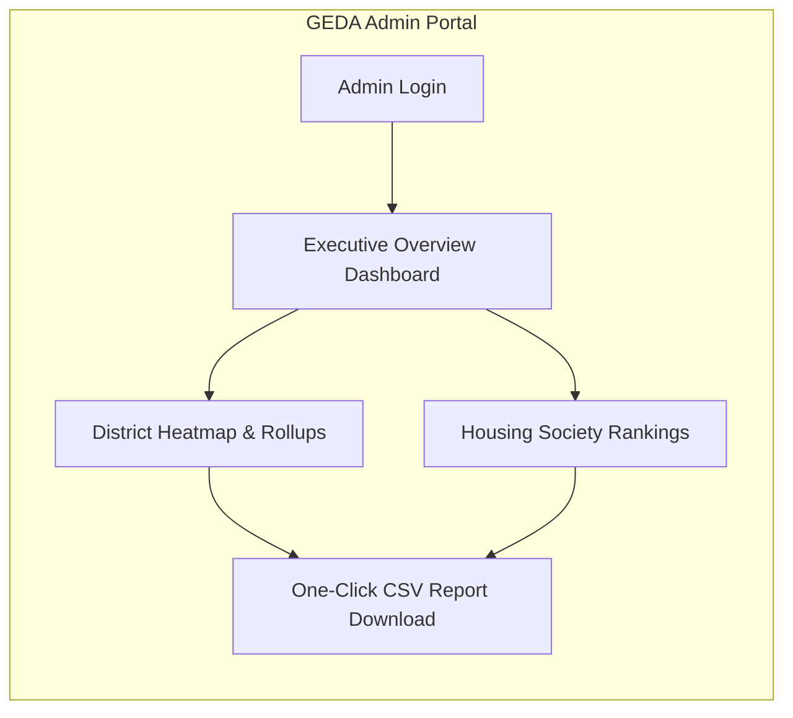
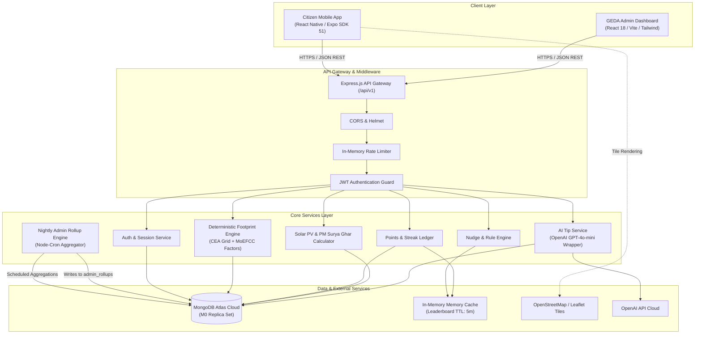
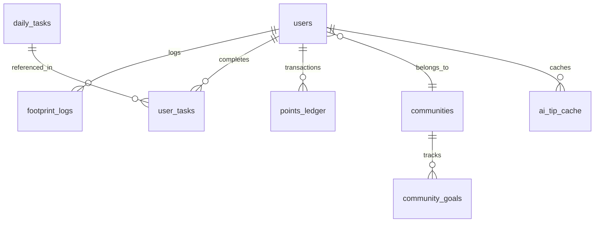
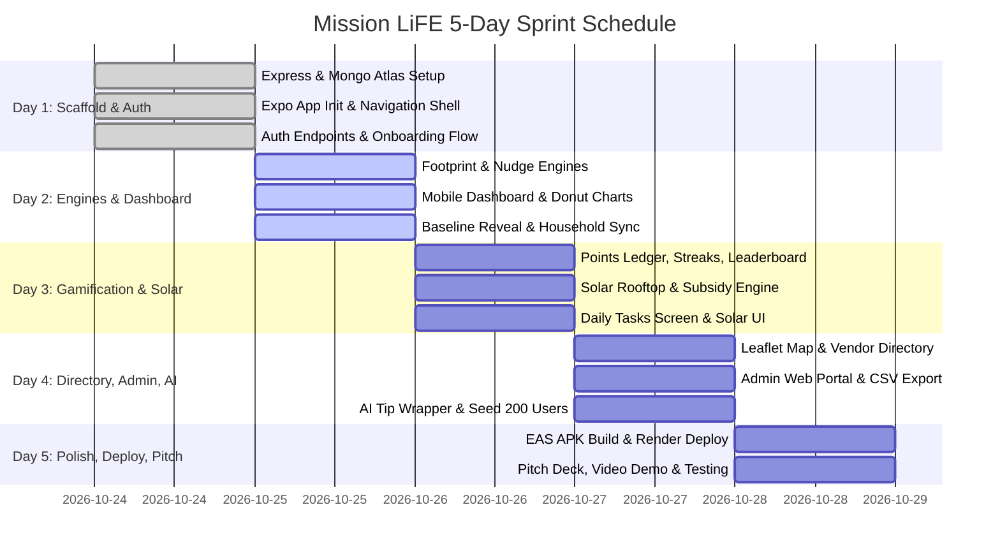

# Mission LiFE (Lifestyle for Environment) — Implementation Plan
**HackCult '26 — GEDA Track (HC26-GEDA01)**  
*5-Day Hackathon Sprint Plan | 3-Person Engineering Team | Mobile-First Hybrid Architecture*

---

## Executive Summary

Mission LiFE is a citizen-centric, gamified sustainability mobile application coupled with a GEDA (Gujarat Energy Development Agency) Administrative Web Portal. It operationalizes India's Mission LiFE philosophy by nudging citizens toward carbon-conscious habits, quantifying domestic energy and transport emissions, calculating PM Surya Ghar rooftop solar ROI, and aggregating neighborhood-level climate action across Gujarat.

> [!IMPORTANT]
> **Hackathon Constraints & Focus**:  
> - **Timeframe**: 5 days (Scaffold → Functional Engine → Gamification & Solar → Directory & Admin → Polish & Pitch).  
> - **Team Composition**: 3 Developers (Person A: Backend/Engines, Person B: Frontend/Mobile UI, Person C: Fullstack/Features & Admin).  
> - **Deliverables**: Working Android APK demo (Expo EAS/local build), Live Backend on Render, MongoDB Atlas cluster, and a live web Admin Dashboard for GEDA evaluators.

---

## 1. Finalised Tech Stack

| Component | Choice | Version / Platform | Rationale |
| :--- | :--- | :--- | :--- |
| **Mobile Client** | **React Native (Expo)** | Expo SDK 51+ / React Native 0.74+ | Rapid development with hot reload, built-in vector icons, effortless APK compilation via EAS Build, and instant native sensor/camera abstractions. |
| **Admin Web View** | **React + Vite / Tailwind** | React 18 / Vite 5 | Lightweight, lightning-fast build time, easily embedded into Express static hosting or deployed on Vercel/Render for GEDA officers. |
| **Backend Runtime** | **Node.js + Express.js** | Node 20 LTS, Express 4.19 | Minimalist, highly scalable event-driven I/O, rapid JSON API prototyping, and unified JavaScript syntax across client and server. |
| **Language** | **JavaScript (ES6+)** | Modern JS (Client & Server) | Eliminates TypeScript transpilation hurdles and type-debugging bottlenecks during a high-speed 5-day hackathon sprint. |
| **Database** | **MongoDB + Mongoose** | MongoDB Atlas M0 (Free Tier) | Document model fits nested survey responses, polymorphic daily tasks, and native 2dsphere geospatial queries for vendor proximity. |
| **Authentication** | **JWT (JSON Web Tokens)** | `jsonwebtoken` + `bcryptjs` | Stateless, mobile-friendly authorization via HTTP `Authorization: Bearer <token>` headers; stored securely in Expo `SecureStore`. |
| **AI Integration** | **OpenAI GPT-4o-mini** | Provider-Agnostic Wrapper | Ultra-low latency (~400ms), extremely low cost (~$0.15/1M input tokens), produces hyper-personalized weekly nudges based on emission profiles. |
| **Mapping Engine** | **Leaflet.js + OpenStreetMap** | Leaflet in Expo `react-native-webview` | 100% free, zero billing/credit-card dependency (unlike Google Maps API), reliable tile rendering, zero quota lockouts during live judging. |
| **Hosting & Infra** | **Render + MongoDB Atlas + EAS** | Render Free Web Service | Cloud-native deployment with auto-deploy from GitHub, SSL termination, and managed Mongo backups. |

---

## 2. MVP Screen List & User Flows

### 2.1 Citizen Mobile App Screens (React Native Expo)

```mermaid
graph TD
    A[Splash Screen] --> B{Auth Token Present?}
    B -->|No| C[Auth Screen: Login / Signup]
    B -->|Yes| D{Onboarding Completed?}
    C -->|New User| E[Onboarding Wizard: 4 Steps]
    E --> F[Baseline Footprint Reveal]
    F --> G[Main Bottom Tab Navigator]
    D -->|No| E
    D -->|Yes| G

    subgraph Bottom Tab Navigation
        G --> H[Tab 1: Home Dashboard]
        G --> I[Tab 2: Daily Action Center]
        G --> J[Tab 3: Leaderboard & Community]
        G --> K[Tab 4: Solar Rooftop Calc]
        G --> L[Tab 5: Vendor Directory & Map]
    end

    H --> M[Profile & Badges Screen]
    M --> N[Social Share Impact Card Modal]
    I --> O[Task Completion & Proof Sheet]
```



#### Detailed Screen Catalog

1. **Splash & Welcome Screen (`SplashScreen.jsx`)**
   - **Purpose**: Verify existing JWT in `SecureStore`, perform handshake with `/api/v1/health`, route user.
   - **Key UI Elements**: Mission LiFE & GEDA co-branded animated logo, version indicator, pulse animation.
   - **Flow**: Transitions to `AuthScreen` or `DashboardScreen`.

2. **Authentication Screen (`AuthScreen.jsx`)**
   - **Purpose**: Citizen signup and login with minimal friction.
   - **Key UI Elements**: Segmented toggle (Login / Register), Mobile Number / Email input, Password field, Society/Apartment picker dropdown (preloaded with Gujarat societies), Terms checkbox.
   - **Flow**: Successful registration routes to `OnboardingWizardScreen`; login routes to `DashboardScreen`.

3. **Onboarding Wizard Screen (`OnboardingWizardScreen.jsx`)**
   - **Purpose**: Collect 5 core household lifestyle data points to compute the citizen's initial carbon baseline.
   - **Key UI Elements**: 4-step progress stepper:
     - *Step 1: Household*: Family size, housing type (Apartment / Independent House), City/District.
     - *Step 2: Electricity*: Average monthly electricity bill (₹) or units (kWh), AC units count & usage hours.
     - *Step 3: Cooking & Gas*: Number of LPG cylinders consumed per quarter (or PNG piped gas).
     - *Step 4: Commute*: Primary commute mode (2-wheeler, 4-wheeler petrol/diesel/EV, bus, metro), daily kilometers.
   - **Flow**: Submits payload to `POST /footprint/calculate`, proceeds to `BaselineRevealScreen`.

4. **Baseline Footprint Reveal Screen (`BaselineRevealScreen.jsx`)**
   - **Purpose**: Dramatic visual reveal of calculated annual carbon footprint (in tonnes CO2e).
   - **Key UI Elements**: Circular animated carbon dial, comparison badge ("22% lower than Ahmedabad urban average!"), prompt to accept first Mission LiFE pledge.
   - **Flow**: Pressing "Start Mission LiFE" routes to `DashboardScreen`.

5. **Home Dashboard Screen (`DashboardScreen.jsx`)**
   - **Purpose**: Central command hub displaying footprint trends, daily AI nudge, and current streak.
   - **Key UI Elements**:
     - *Top Bar*: Current streak count (🔥 12 days), Total Green Points (⭐ 450 pts), Profile Avatar.
     - *Today's AI Nudge Card*: Personalized recommendation (e.g., *"Set AC to 26°C tonight to save 1.8 kWh and 1.5 kg CO2"*), with an "Accept Nudge" button.
     - *Footprint Breakdown Chart*: SVG Donut chart (Electricity, Transport, LPG, Waste).
     - *Quick Action Grid*: Shortcuts to Solar Calc, Daily Tasks, and Vendor Map.
   - **Flow**: Tapping charts navigates to detailed breakdown; tapping nudge opens `TaskDetailModal`.

6. **Daily Tasks & Action Center Screen (`TasksScreen.jsx`)**
   - **Purpose**: Gamified catalog of daily lifestyle micro-actions categorized by Mission LiFE's 7 themes.
   - **Key UI Elements**:
     - Category filter pills: *Save Energy, Save Water, Say No to Single-Use Plastic, Reduce Waste, Sustainable Food*.
     - Task Cards: Title, CO2 offset badge (e.g., `+0.4 kg CO2e saved`), Green Points reward (`+25 pts`), Checkbox/Swipe to complete.
     - Daily Progress Bar: "3 of 5 tasks completed today".
   - **Flow**: Tapping a task opens `TaskProofModal` for photo upload or simple affirmation.

7. **Leaderboard & Community Screen (`LeaderboardScreen.jsx`)**
   - **Purpose**: Fosters social motivation through hyper-local peer rankings and collective goals.
   - **Key UI Elements**:
     - Segmented Tabs: `My Society` vs `My City (e.g., Surat)` vs `Top Gujarat Wards`.
     - Podium display for Top 3 eco-champions.
     - Scrollable user rankings with avatar, rank, streak, and total points.
     - *Community Goal Card*: "Goyal Greens Society Solar Pledge: 12,400 / 20,000 kg CO2 saved" with animated progress bar.
   - **Flow**: Tapping a user shows public badges; tapping community card shows society members.

8. **Solar Rooftop Calculator Screen (`SolarCalcScreen.jsx`)**
   - **Purpose**: Calculate solar rooftop sizing, financial savings, and PM Surya Ghar Muft Bijli Yojana subsidies.
   - **Key UI Elements**:
     - *Inputs*: Available shadow-free roof area (sq ft slider), Average monthly electricity bill (₹ slider), District selection.
     - *Outputs Visuals*:
       - Recommended system capacity (kWp).
       - Estimated Project Cost vs **PM Surya Ghar Central Subsidy** (up to ₹78,000) breakdown.
       - Net Customer Investment.
       - Annual savings in ₹ & estimated payback period (e.g., 3.8 years).
       - Lifetime CO2 avoided (metric tonnes).
     - *CTA*: "Connect with GEDA Certified Solar Installers" (deep links to Vendor Directory).
   - **Flow**: Tapping CTA navigates to `VendorDirectoryScreen` with category pre-filtered to `solar_installer`.

9. **Vendor Directory & Proximity Map Screen (`VendorDirectoryScreen.jsx`)**
   - **Purpose**: Discover verified clean-tech vendors, solar installers, and recycling centers across Gujarat.
   - **Key UI Elements**:
     - Header View Switcher: `List View` vs `Map View`.
     - Filter Chips: `Rooftop Solar`, `EV Charging`, `E-Waste Drop-off`, `Energy Audits`.
     - Interactive Leaflet Map: Centered on user's district with custom green pin markers.
     - Vendor Bottom Sheet / Cards: GEDA verification badge (`✓ GEDA Certified`), address, direct "Call Vendor" and "Open in Maps" action buttons.
   - **Flow**: Tapping a vendor marker highlights card in list; initiates direct phone call via `Linking.openURL('tel:...')`.

10. **Profile, Badges & Impact Card Screen (`ProfileScreen.jsx`)**
    - **Purpose**: Showcase individual environmental achievements and generate viral social impact cards.
    - **Key UI Elements**:
      - Citizen level (e.g., *Level 4: Urja Rakshak*).
      - Badges Showcase Grid: Unlocked & locked badges (e.g., *Solar Explorer, 7-Day Zero Waste Streak, Grid Guardian*).
      - Cumulative impact metrics: Total kWh saved, total LPG conserved, total CO2 offset.
      - "Share My Impact Card" button.
    - **Flow**: Tapping share triggers `react-native-view-shot` to produce a branded Instagram/WhatsApp story image.

---

### 2.2 Admin Web Dashboard Screens (GEDA Officers)



1. **GEDA Executive Overview Dashboard (`/admin/dashboard`)**
   - **Purpose**: High-level macro view of statewide Mission LiFE participation and emission abatement metrics.
   - **Key UI Elements**:
     - 4 Top Metric KPI Cards: Total Active Citizens, Total Verified CO2 Avoided (Tonnes), Total Clean Energy Generated (kWh equiv.), Enrolled Housing Societies.
     - Statewide District Bar Chart (CO2 reduction by district: Ahmedabad, Surat, Vadodara, Rajkot, etc.).
     - Live Feed: Recent high-impact actions logged across Gujarat.
   - **Flow**: Filterable by date range (Today, 7 Days, Month, YTD).

2. **District & Society Drilldown View (`/admin/districts`)**
   - **Purpose**: Enable GEDA administrators to identify top performing municipal wards and underperforming rural districts.
   - **Key UI Elements**:
     - Interactive tabular list with search, sorting by participation rate and carbon saved.
     - "Export GEDA Report (.CSV)" button generating an official audit report.

---

## 3. System Architecture

### 3.1 High-Level Component Diagram



### 3.2 Architectural Flow & Separation of Concerns

1. **API Layer Structure**:
   - All client routes are unified under `/api/v1/*`.
   - Centralized error-handling middleware intercepting custom `AppError(statusCode, message)`.
   - Request validation middleware sanitizing numeric inputs (bill amounts, roof area, coordinates).
2. **Deterministic Calculation vs. Generative AI**:
   - All carbon metrics, solar capacities, financial tariffs, and PM Surya Ghar subsidies are computed **deterministically** using verified Indian standards (CEA CO2 baseline database for power, GEDA tariff orders, MNRE guidelines).
   - Generative AI (GPT-4o-mini) is **strictly restricted** to qualitative contextual micro-nudges and natural language lifestyle suggestions. AI responses are validated and cached to prevent latency or API quota exhaustion.
3. **Caching & Performance Optimization**:
   - Leaderboard computations (city and society wide) are cached using an in-memory TTL store (5-minute refresh interval) to protect MongoDB free-tier throughput.
   - AI tips are cached for 7 days per user in the `ai_tip_cache` collection.
4. **Nightly Rollup Architecture for Admin**:
   - High-volume granular task logs are not queried on-demand by the Admin Web Dashboard.
   - An asynchronous aggregation script computes daily rollups per district and housing society, inserting summary documents into `admin_rollups` for sub-50ms admin page loads.

---

## 4. MongoDB Schema Design



### Detailed Schema Specifications

#### 1. `users` Collection
Stores user profiles, credentials, household demographics, and gamification aggregates.
```javascript
{
  _id: ObjectId,
  fullName: { type: String, required: true },
  phone: { type: String, unique: true, sparse: true },
  email: { type: String, required: true, unique: true, lowercase: true, index: true },
  passwordHash: { type: String, required: true },
  role: { type: String, enum: ['citizen', 'admin'], default: 'citizen' },
  district: { type: String, required: true, index: true }, // e.g., 'Ahmedabad'
  city: { type: String, required: true },
  communityId: { type: ObjectId, ref: 'communities', index: true, default: null },
  household: {
    size: { type: Number, default: 4 },
    houseType: { type: String, enum: ['apartment', 'individual_house'], default: 'apartment' },
    monthlyUnitsKWh: { type: Number, default: 0 },
    hasAC: { type: Boolean, default: false },
    acCount: { type: Number, default: 0 },
    lpgCylindersPerQuarter: { type: Number, default: 2 },
    primaryCommute: { 
      type: String, 
      enum: ['two_wheeler_petrol', 'four_wheeler_petrol', 'four_wheeler_diesel', 'ev', 'bus', 'metro', 'bicycle'], 
      default: 'two_wheeler_petrol' 
    },
    dailyCommuteKm: { type: Number, default: 10 }
  },
  baselineAnnualCO2Kg: { type: Number, default: 0 },
  totalPoints: { type: Number, default: 0, index: -1 }, // Descending index for fast leaderboard
  currentStreakDays: { type: Number, default: 0 },
  lastActiveDate: { type: Date, default: null },
  badgesEarned: [{
    badgeCode: { type: String },
    earnedAt: { type: Date, default: Date.now }
  }],
  createdAt: { type: Date, default: Date.now },
  updatedAt: { type: Date, default: Date.now }
}
```
- **Indexes**:
  - `{ email: 1 }` (Unique)
  - `{ district: 1, totalPoints: -1 }` (District Leaderboard)
  - `{ communityId: 1, totalPoints: -1 }` (Society Leaderboard)

---

#### 2. `footprint_logs` Collection
Historical log of user emission calculations and lifestyle audits.
```javascript
{
  _id: ObjectId,
  userId: { type: ObjectId, ref: 'users', required: true, index: true },
  date: { type: Date, default: Date.now, index: true },
  periodType: { type: String, enum: ['baseline', 'monthly_audit'], default: 'monthly_audit' },
  breakdown: {
    electricityCO2Kg: { type: Number, required: true },
    lpgCO2Kg: { type: Number, required: true },
    commuteCO2Kg: { type: Number, required: true },
    wasteFoodCO2Kg: { type: Number, required: true }
  },
  totalCO2Kg: { type: Number, required: true },
  rawInputsSnapshot: { type: Object } // Preserves inputs for comparison
}
```
- **Indexes**:
  - `{ userId: 1, date: -1 }` (Historical trends per user)

---

#### 3. `daily_tasks` Collection
Master catalog of pre-configured Mission LiFE sustainable lifestyle tasks.
```javascript
{
  _id: ObjectId,
  taskCode: { type: String, unique: true }, // e.g., 'SAVE_ENERGY_AC_24'
  title: { type: String, required: true },
  description: { type: String, required: true },
  category: { 
    type: String, 
    enum: [
      'save_energy', 
      'save_water', 
      'say_no_to_plastic', 
      'sustainable_food', 
      'reduce_waste', 
      'healthy_lifestyle', 
      'reduce_ewaste'
    ],
    required: true,
    index: true
  },
  co2SavedKg: { type: Number, required: true }, // Standard offset per completion
  pointsReward: { type: Number, required: true, default: 20 },
  proofType: { type: String, enum: ['honor_system', 'photo_upload'], default: 'honor_system' },
  isActive: { type: Boolean, default: true }
}
```
- **Indexes**:
  - `{ category: 1, isActive: 1 }`

---

#### 4. `user_tasks` Collection
Daily completion instances logged by citizens.
```javascript
{
  _id: ObjectId,
  userId: { type: ObjectId, ref: 'users', required: true, index: true },
  taskId: { type: ObjectId, ref: 'daily_tasks', required: true },
  completedDate: { type: String, required: true, index: true }, // Format: 'YYYY-MM-DD'
  co2SavedKg: { type: Number, required: true },
  pointsEarned: { type: Number, required: true },
  createdAt: { type: Date, default: Date.now }
}
```
- **Indexes**:
  - `{ userId: 1, completedDate: 1 }`
  - `{ userId: 1, taskId: 1, completedDate: 1 }` (Unique compound index preventing double completion per day)

---

#### 5. `points_ledger` Collection
Immutable append-only ledger for gamification integrity and auditing.
```javascript
{
  _id: ObjectId,
  userId: { type: ObjectId, ref: 'users', required: true, index: true },
  transactionType: { 
    type: String, 
    enum: ['TASK_COMPLETION', 'STREAK_BONUS', 'ONBOARDING_BONUS', 'SOLAR_CALC_BONUS'], 
    required: true 
  },
  pointsDelta: { type: Number, required: true }, // Positive number
  balanceAfter: { type: Number, required: true },
  referenceId: { type: String, default: null }, // e.g., user_task ID or badge code
  createdAt: { type: Date, default: Date.now }
}
```
- **Indexes**:
  - `{ userId: 1, createdAt: -1 }`

---

#### 6. `badges` Collection
Defines available gamification awards.
```javascript
{
  _id: ObjectId,
  badgeCode: { type: String, unique: true, required: true }, // e.g., 'URJA_MITRA'
  title: { type: String, required: true },
  description: { type: String, required: true },
  iconUrl: { type: String, required: true },
  criteriaType: { 
    type: String, 
    enum: ['POINTS_THRESHOLD', 'STREAK_DAYS', 'SOLAR_CALC_RUN', 'CO2_SAVED_THRESHOLD'],
    required: true 
  },
  criteriaValue: { type: Number, required: true }
}
```

---

#### 7. `communities` Collection
Societies, wards, universities, and commercial clusters in Gujarat.
```javascript
{
  _id: ObjectId,
  name: { type: String, required: true }, // e.g., 'Shantigram Township'
  type: { type: String, enum: ['housing_society', 'ward', 'college', 'office'], default: 'housing_society' },
  district: { type: String, required: true, index: true }, // e.g., 'Ahmedabad'
  city: { type: String, required: true },
  pincode: { type: String, required: true },
  memberCount: { type: Number, default: 0 },
  totalCO2AvoidedKg: { type: Number, default: 0, index: -1 },
  totalPoints: { type: Number, default: 0, index: -1 },
  createdAt: { type: Date, default: Date.now }
}
```
- **Indexes**:
  - `{ district: 1, totalPoints: -1 }`

---

#### 8. `community_goals` Collection
Collective sustainability milestones set for a society or ward.
```javascript
{
  _id: ObjectId,
  communityId: { type: ObjectId, ref: 'communities', required: true, index: true },
  title: { type: String, required: true }, // e.g., '10 Tonne Society CO2 Reduction Challenge'
  targetCO2Kg: { type: Number, required: true },
  currentCO2Kg: { type: Number, default: 0 },
  startDate: { type: Date, default: Date.now },
  endDate: { type: Date, required: true },
  isAchieved: { type: Boolean, default: false }
}
```

---

#### 9. `vendor_directory` Collection
Clean-tech service providers, solar vendors, and recycling drop-offs.
```javascript
{
  _id: ObjectId,
  businessName: { type: String, required: true },
  category: { 
    type: String, 
    enum: ['solar_installer', 'ev_charger', 'energy_auditor', 'waste_recycler'], 
    required: true,
    index: true 
  },
  district: { type: String, required: true, index: true },
  address: { type: String, required: true },
  location: {
    type: { type: String, enum: ['Point'], default: 'Point' },
    coordinates: { type: [Number], required: true } // [Longitude, Latitude]
  },
  phone: { type: String, required: true },
  email: { type: String },
  rating: { type: Number, default: 4.8 },
  isGedaCertified: { type: Boolean, default: true, index: true },
  createdAt: { type: Date, default: Date.now }
}
```
- **Indexes**:
  - `{ location: '2dsphere' }` (Critical for geospatial radius queries)
  - `{ category: 1, district: 1 }`

---

#### 10. `admin_rollups` Collection
Pre-aggregated rollups for instant GEDA admin dashboard analytics.
```javascript
{
  _id: ObjectId,
  rollupDate: { type: String, required: true, index: true }, // 'YYYY-MM-DD'
  district: { type: String, required: true, index: true },
  activeCitizensCount: { type: Number, default: 0 },
  totalCO2AvoidedKg: { type: Number, default: 0 },
  totalPointsEarned: { type: Number, default: 0 },
  activeSocietiesCount: { type: Number, default: 0 },
  topPerformingSociety: {
    communityId: { type: ObjectId, ref: 'communities' },
    name: { type: String },
    co2SavedKg: { type: Number }
  },
  createdAt: { type: Date, default: Date.now }
}
```
- **Indexes**:
  - `{ rollupDate: -1, district: 1 }`

---

#### 11. `ai_tip_cache` Collection
Stores personalized AI-generated tips to eliminate repetitive OpenAI API calls.
```javascript
{
  _id: ObjectId,
  userId: { type: ObjectId, ref: 'users', required: true, index: true },
  weekIdentifier: { type: String, required: true, index: true }, // e.g., '2026-W44'
  focusCategory: { type: String, required: true }, // e.g., 'electricity'
  tipTitle: { type: String, required: true },
  tipMarkdown: { type: String, required: true },
  potentialMonthlySavingsINR: { type: Number, default: 0 },
  expiresAt: { type: Date, required: true, index: { expires: 0 } } // MongoDB TTL index
}
```
- **Indexes**:
  - `{ userId: 1, weekIdentifier: 1 }` (Unique compound index)

---

## 5. REST API Contract

All endpoints are hosted at `/api/v1` and communicate via JSON payloads.

### 5.1 Authentication (`/api/v1/auth`)

#### `POST /auth/register`
- **Auth Required**: No
- **Description**: Register a new citizen and initialise starting gamification points.
- **Request Body**:
```json
{
  "fullName": "Siddharth Mehta",
  "email": "sid.mehta@example.com",
  "password": "Password123!",
  "phone": "9876543210",
  "district": "Surat",
  "city": "Surat",
  "communityId": "664fa1e2b58832a8748d1012"
}
```
- **Response (201 Created)**:
```json
{
  "success": true,
  "token": "eyJhbGciOiJIUzI1NiIsInR5cCI6IkpXVCJ9...",
  "user": {
    "id": "664fa231b58832a8748d1015",
    "fullName": "Siddharth Mehta",
    "email": "sid.mehta@example.com",
    "district": "Surat",
    "totalPoints": 50
  }
}
```

#### `POST /auth/login`
- **Auth Required**: No
- **Description**: Citizen / Admin authentication returning a JWT.
- **Request Body**:
```json
{
  "email": "sid.mehta@example.com",
  "password": "Password123!"
}
```
- **Response (200 OK)**:
```json
{
  "success": true,
  "token": "eyJhbGciOiJIUzI1NiIsInR5cCI6IkpXVCJ9...",
  "user": {
    "id": "664fa231b58832a8748d1015",
    "fullName": "Siddharth Mehta",
    "role": "citizen",
    "district": "Surat",
    "totalPoints": 150,
    "currentStreakDays": 3
  }
}
```

---

### 5.2 User Profile & Badges (`/api/v1/users`)

#### `GET /users/me`
- **Auth Required**: Yes (`Bearer <token>`)
- **Description**: Returns authenticated user's profile and current household specs.
- **Response (200 OK)**:
```json
{
  "success": true,
  "data": {
    "id": "664fa231b58832a8748d1015",
    "fullName": "Siddharth Mehta",
    "email": "sid.mehta@example.com",
    "district": "Surat",
    "totalPoints": 150,
    "currentStreakDays": 3,
    "baselineAnnualCO2Kg": 3280.4,
    "household": {
      "size": 4,
      "houseType": "apartment",
      "monthlyUnitsKWh": 320,
      "primaryCommute": "two_wheeler_petrol"
    }
  }
}
```

#### `PATCH /users/me`
- **Auth Required**: Yes
- **Description**: Update household profile parameters.
- **Request Body**:
```json
{
  "household": {
    "monthlyUnitsKWh": 290,
    "hasAC": true,
    "acCount": 2
  }
}
```

#### `GET /users/me/badges`
- **Auth Required**: Yes
- **Description**: Get list of all unlocked and locked badges.
- **Response (200 OK)**:
```json
{
  "success": true,
  "data": [
    {
      "badgeCode": "URJA_ARAMBH",
      "title": "Eco Starter",
      "isUnlocked": true,
      "earnedAt": "2026-10-24T10:00:00.000Z"
    },
    {
      "badgeCode": "SOLAR_PIONEER",
      "title": "Solar Pioneer",
      "isUnlocked": false,
      "criteria": "Run solar rooftop estimation calculation"
    }
  ]
}
```

---

### 5.3 Footprint Engine (`/api/v1/footprint`)

#### `POST /footprint/calculate`
- **Auth Required**: Yes
- **Description**: Computes annual carbon footprint breakdown based on household input parameters and updates baseline.
- **Request Body**:
```json
{
  "monthlyElectricityKWh": 300,
  "lpgCylindersPerQuarter": 2,
  "commuteType": "two_wheeler_petrol",
  "dailyCommuteKm": 15,
  "familySize": 4
}
```
- **Response (200 OK)**:
```json
{
  "success": true,
  "data": {
    "annualCO2Kg": 3724.8,
    "annualCO2Tonnes": 3.72,
    "perCapitaAnnualCO2Tonnes": 0.93,
    "breakdown": {
      "electricityCO2Kg": 2952.0,
      "lpgCO2Kg": 228.0,
      "commuteCO2Kg": 191.6,
      "wasteFoodCO2Kg": 353.2
    },
    "comparison": {
      "gujaratUrbanAvgTonnes": 4.10,
      "percentageDifference": -9.2
    }
  }
}
```

#### `GET /footprint/history`
- **Auth Required**: Yes
- **Description**: Returns historic footprint audit logs for progress graphs.

---

### 5.4 Daily Tasks & Challenges (`/api/v1/tasks`)

#### `GET /tasks/today`
- **Auth Required**: Yes
- **Description**: Retrieves curated list of 5 daily tasks for the user, indicating already completed tasks today.
- **Response (200 OK)**:
```json
{
  "success": true,
  "data": [
    {
      "taskId": "664fc019b58832a8748d2001",
      "title": "Optimal Cooling (24°C+)",
      "description": "Keep air conditioning thermostat at 24°C or above for at least 4 hours.",
      "category": "save_energy",
      "co2SavedKg": 1.2,
      "pointsReward": 25,
      "isCompletedToday": false
    },
    {
      "taskId": "664fc019b58832a8748d2002",
      "title": "Zero Single-Use Plastic Bag",
      "description": "Carried reusable cloth bag for daily grocery/vegetable shopping.",
      "category": "say_no_to_plastic",
      "co2SavedKg": 0.3,
      "pointsReward": 15,
      "isCompletedToday": true
    }
  ]
}
```

#### `POST /tasks/:id/complete`
- **Auth Required**: Yes
- **Description**: Mark a task as completed today, credits points, increments streak.
- **Response (200 OK)**:
```json
{
  "success": true,
  "message": "Task completed successfully!",
  "pointsAwarded": 25,
  "newTotalPoints": 175,
  "streakDays": 4,
  "co2AvoidedKg": 1.2
}
```

---

### 5.5 Gamification & Leaderboard (`/api/v1/points`)

#### `GET /points/leaderboard?scope=city|society&district=Surat`
- **Auth Required**: Yes
- **Description**: Returns top 20 rankings with cached fast lookup.
- **Response (200 OK)**:
```json
{
  "success": true,
  "scope": "society",
  "communityName": "Goyal Greens Residency",
  "leaderboard": [
    { "rank": 1, "userId": "...", "name": "Bhavik Patel", "points": 820, "streak": 14 },
    { "rank": 2, "userId": "...", "name": "Siddharth Mehta", "points": 745, "streak": 11 }
  ],
  "currentUserRank": {
    "rank": 2,
    "points": 745
  }
}
```

---

### 5.6 Solar Rooftop Calculator (`/api/v1/solar`)

#### `POST /solar/calculate`
- **Auth Required**: Yes (or optional for guest preview)
- **Description**: Sizing, generation, financial payback, and PM Surya Ghar Muft Bijli Yojana calculation.
- **Request Body**:
```json
{
  "roofAreaSqFt": 350,
  "monthlyBillINR": 3500,
  "district": "Ahmedabad"
}
```
- **Response (200 OK)**:
```json
{
  "success": true,
  "data": {
    "recommendedCapacityKW": 3.0,
    "roofAreaRequiredSqFt": 300,
    "annualGenerationKWh": 4380,
    "financials": {
      "estimatedGrossCostINR": 150000,
      "pmSuryaGharSubsidyINR": 78000,
      "gujaratStateSubsidyINR": 0,
      "netCostToCitizenINR": 72000,
      "estimatedAnnualSavingsINR": 28470,
      "simplePaybackYears": 2.53
    },
    "environmentalImpact": {
      "annualCO2AvoidedKg": 3591.6,
      "treesEquivalent": 163
    }
  }
}
```

---

### 5.7 Clean-Tech Vendor Directory (`/api/v1/vendors`)

#### `GET /vendors?category=solar_installer&lat=23.0225&lng=72.5714&radiusKm=25`
- **Auth Required**: No
- **Description**: Geospatial query searching verified providers within a radius in Gujarat.
- **Response (200 OK)**:
```json
{
  "success": true,
  "count": 4,
  "data": [
    {
      "id": "664fc890b58832a8748d3011",
      "businessName": "Gujarat Green Power Solutions",
      "category": "solar_installer",
      "address": "Opp. GEDA Office, Race Course Rd, Vadodara",
      "district": "Vadodara",
      "phone": "+919428012345",
      "rating": 4.9,
      "isGedaCertified": true,
      "distanceKm": 4.2,
      "coordinates": [72.5801, 23.0310]
    }
  ]
}
```

---

### 5.8 AI Nudge Service (`/api/v1/ai`)

#### `GET /ai/tip`
- **Auth Required**: Yes
- **Description**: Returns customized weekly tip generated via GPT-4o-mini, backed by 7-day MongoDB cache.
- **Response (200 OK)**:
```json
{
  "success": true,
  "source": "cache",
  "data": {
    "focusCategory": "electricity",
    "tipTitle": "High Cooling Load Detected",
    "tipMarkdown": "Your electricity consumption is 38% above Surat's median. By using ceiling fans in tandem with your AC set strictly at 25°C, your household can save approx ₹640 on your next DGVCL bill while offsetting 72 kg CO2 this month.",
    "potentialMonthlySavingsINR": 640
  }
}
```

---

### 5.9 GEDA Admin Analytics (`/api/v1/admin`)

#### `GET /admin/stats`
- **Auth Required**: Yes (Role: `admin`)
- **Description**: State-level aggregated KPIs for GEDA executive dashboard.
- **Response (200 OK)**:
```json
{
  "success": true,
  "data": {
    "totalCitizensRegistered": 18450,
    "totalCO2AvoidedTonnes": 482.6,
    "enrolledCommunitiesCount": 214,
    "solarEstimationsRun": 5420
  }
}
```

#### `GET /admin/districts`
- **Auth Required**: Yes (Role: `admin`)
- **Description**: District-wise breakdown across Gujarat for comparison charts.

#### `GET /admin/export.csv`
- **Auth Required**: Yes (Role: `admin`)
- **Description**: Downloads streamable CSV audit spreadsheet of ward and society performance.

---

## 6. 5-Day Build Plan



### Detailed Day-by-Day Team Responsibility Matrix

#### **Day 1: Scaffold, Auth & Onboarding Flow**
- **Person A (Backend-Heavy)**:
  - Initialize Express backend structure (`/routes`, `/controllers`, `/models`, `/middlewares`, `/config`).
  - Configure MongoDB Atlas cluster connection with connection pooling.
  - Implement `User` schema, password hashing with `bcryptjs`, and JWT sign/verify middleware.
  - Deliver `POST /auth/register` and `POST /auth/login`.
- **Person B (Frontend-Heavy)**:
  - Scaffold React Native Expo SDK 51 application.
  - Setup core design system (palette: Forest Green `#1E5128`, Sage `#4E9F3D`, Pale `#D8E9A8`, Dark `#191A19`).
  - Implement bottom tab navigation (`expo-router` or `@react-navigation/bottom-tabs`).
  - Build polished `AuthScreen` (Login / Register segmented toggle).
- **Person C (Fullstack/Features)**:
  - Build `OnboardingWizardScreen` (4-step stepper collecting units, appliances, commute, LPG).
  - Connect mobile auth forms with Person A's backend using `Axios` and Expo `SecureStore`.
  - Prepare mock seed data for 10 Gujarat Housing Societies.

#### **Day 2: Footprint Engine, Home Dashboard & Nudge Engine**
- **Person A (Backend-Heavy)**:
  - Implement deterministic `footprintEngine.js` with CEA India grid factors and MoEFCC emission baselines.
  - Build `POST /footprint/calculate` and `GET /footprint/history`.
  - Create rule-based `nudgeEngine.js` identifying user's highest emitting category and selecting targeted nudges.
- **Person B (Frontend-Heavy)**:
  - Build `DashboardScreen.jsx` with header streak counter, green points card, and quick action buttons.
  - Implement dynamic Footprint Donut Chart using `react-native-svg` or `victory-native`.
  - Design "Today's AI Nudge" highlight card with interactive dismissal and action button.
- **Person C (Fullstack/Features)**:
  - Implement `BaselineRevealScreen` with animated carbon odometer dial.
  - Wire onboarding completion to submit footprint calculation and display the baseline comparison.
  - Implement user profile settings screen (`ProfileScreen.jsx`).

#### **Day 3: Gamification, Daily Challenges & Solar Calculator**
- **Person A (Backend-Heavy)**:
  - Build `pointsLedger.js` logic with atomic transactions (task completion, streak maintenance).
  - Seed 25 standardized Mission LiFE tasks in `daily_tasks`.
  - Implement `GET /tasks/today` and `POST /tasks/:id/complete` with duplicate-prevention index.
  - Build `solarEngine.js` implementing PM Surya Ghar Muft Bijli Yojana subsidy logic and Gujarat tariff slabs.
- **Person B (Frontend-Heavy)**:
  - Build `TasksScreen.jsx` with category filter chips and completion checkboxes.
  - Build `TaskProofModal` with celebratory points animation on completion.
  - Design `SolarCalcScreen.jsx` featuring dynamic roof area & bill sliders and real-time ROI calculation updates.
- **Person C (Fullstack/Features)**:
  - Implement `GET /points/leaderboard` with 5-minute in-memory caching.
  - Build `LeaderboardScreen.jsx` (Society vs City tabs with Top-3 podium UI).
  - Build badge evaluation service awarding badges upon milestone completion.

#### **Day 4: Vendor Directory, Admin Web Dashboard, AI & Seed Data**
- **Person A (Backend-Heavy)**:
  - Implement 2dsphere geospatial search in `vendor_directory` (`GET /vendors`).
  - Build `aiService.js` calling OpenAI `gpt-4o-mini` with strict schema prompt and 7-day MongoDB caching.
  - Write `seed.js` script injecting **200 realistic Gujarat users**, 8 housing societies, 15 GEDA-certified solar vendors, and historical task logs.
- **Person B (Frontend-Heavy)**:
  - Implement `VendorDirectoryScreen.jsx` embedding Leaflet.js inside `react-native-webview` with custom green pin markers.
  - Build vendor cards bottom-sheet with direct telephone dialer (`Linking.openURL`).
  - Implement `react-native-view-shot` on `ProfileScreen` to export shareable WhatsApp story impact cards.
- **Person C (Fullstack/Features)**:
  - Develop the standalone **GEDA Admin Web Dashboard** in `/admin` (React/Vite or Tailwind webview).
  - Connect admin dashboard to `GET /admin/stats` and `GET /admin/districts`.
  - Implement CSV generation endpoint (`GET /admin/export.csv`) using `json2csv` stream.

#### **Day 5: Polish, Deployment, Video Walkthrough & Pitch Deck**
- **Person A (Backend-Heavy)**:
  - Deploy Node/Express backend to **Render Web Service** with MongoDB Atlas production connection.
  - Verify environment variables, CORS policies, and rate limits.
  - Write automated health-check tests verifying all 9 endpoint groups.
- **Person B (Frontend-Heavy)**:
  - Configure `app.json` for Expo EAS Build and generate production Android `.apk`.
  - Test APK installation on physical Android devices.
  - UI micro-interaction polish (haptics, loading skeletons, error snackbars).
- **Person C (Fullstack/Features)**:
  - Record a 2-minute clean video walkthrough of the mobile app flow + GEDA admin dashboard.
  - Complete the GitHub `README.md` with architecture diagrams and API documentation.
  - Structure the HackCult '26 Pitch Deck (Problem Statement, Mission LiFE Alignment, Architecture, Live Demo, GEDA Scalability).

---

## 7. Configuration File Plan

To maintain modularity and avoid hardcoding values in business logic, all environmental constants, discom tariffs, and government subsidies reside in dedicated configuration modules.

### 7.1 Emission Factors (`server/config/emissionFactors.js`)

```javascript
/**
 * Mission LiFE Emission Factors (India & Gujarat Specific)
 * Sources: 
 * - CEA CO2 Baseline Database for the Indian Power Sector (Ver 19)
 * - MoEFCC India GHG Program & IPCC Guidelines
 */
module.exports = {
  // Electricity: Combined Margin for Western Regional Grid (kg CO2e per kWh)
  GRID_ELECTRICITY_KG_CO2_PER_KWH: 0.82,

  // LPG: Domestic 14.2 kg Cylinder (kg CO2e per standard cylinder)
  // ~1.98 kg CO2e per kg of LPG * 14.2 kg = 28.1 kg CO2e
  LPG_CYLINDER_14_2_KG_CO2: 28.12,

  // Transport: Average Indian Vehicle Fleet Factors (kg CO2e per passenger-km)
  TRANSPORT_EMISSIONS_KG_PER_KM: {
    two_wheeler_petrol: 0.035,   // ~35g/km for 100-150cc bike
    four_wheeler_petrol: 0.142,  // ~142g/km for compact hatchback
    four_wheeler_diesel: 0.168,  // ~168g/km for diesel sedan/SUV
    four_wheeler_cng: 0.105,     // ~105g/km for CNG
    ev_two_wheeler: 0.012,       // Grid-charged emission equivalent
    ev_four_wheeler: 0.048,      // Grid-charged emission equivalent
    bus_public: 0.018,           // Per passenger-km occupancy basis
    metro_transit: 0.009,        // Electric transit per passenger-km
    bicycle_walk: 0.000          // Zero direct emissions
  },

  // Food & Waste: Per Capita Municipal Solid Waste Baseline (kg CO2e per person per year)
  ANNUAL_PER_CAPITA_WASTE_FOOD_CO2_KG: 88.3
};
```

---

### 7.2 Solar PV & PM Surya Ghar Subsidy Constants (`server/config/solarConstants.js`)

```javascript
/**
 * PM Surya Ghar Muft Bijli Yojana & Solar Sizing Constants
 * Sources: Ministry of New and Renewable Energy (MNRE) 2024 Guidelines
 */
module.exports = {
  // Average Daily Solar Generation in Gujarat (kWh generated per kWp installed per day)
  // Gujarat boasts high GHI: ~4.2 to 4.8 peak sun hours
  GUJARAT_AVG_DAILY_GENERATION_KWH_PER_KW: 4.3,

  // Annual Generation Multiplier (4.3 kWh * 365 days = ~1,570 kWh/year/kW)
  ANNUAL_GENERATION_KWH_PER_KW: 1570,

  // Rooftop Space Requirement (sq ft per 1 kWp system using 540W Mono PERC panels)
  ROOF_AREA_SQFT_PER_KW: 100,

  // Benchmark Turnkey Installation Cost in Gujarat (₹ per kWp, incl. bi-directional net meter)
  BENCHMARK_COST_INR_PER_KW: 50000,

  // PM Surya Ghar: Central Government Subsidy Structure (Valid 2024-2026)
  PM_SURYA_GHAR_SUBSIDY: {
    FIRST_KW_SUBSIDY_INR: 30000,       // ₹30,000 for the 1st kW
    SECOND_KW_SUBSIDY_INR: 30000,      // ₹30,000 for the 2nd kW (Total ₹60k for 2kW)
    ADDITIONAL_KW_SUBSIDY_INR: 18000,  // ₹18,000 for the 3rd kW
    MAX_CENTRAL_SUBSIDY_INR: 78000     // Maximum capped subsidy for >= 3 kW
  },

  // Gujarat State Top-Up Scheme (Surya Gujarat / State Government Subsidy)
  // Configurable flag: Unconfirmed whether state top-up stacks directly with PM Surya Ghar in 2026
  GUJARAT_STATE_SUBSIDY_CONFIG: {
    IS_STATE_TOPUP_ACTIVE: false,      // Set to true if confirmed by GEDA during hackathon
    SUBSIDY_PERCENTAGE_UPTO_3KW: 0.0,  // Historically 40% under older Surya Gujarat scheme
    SUBSIDY_PERCENTAGE_ABOVE_3KW: 0.0  // Historically 20%
  }
};
```

---

### 7.3 Discom Tariff Slabs (`server/config/tariffSlabs.js`)

```javascript
/**
 * Gujarat Domestic Power Discom Tariff Slabs (DGVCL, MGVCL, PGVCL, UGVCL)
 * Source: GERC (Gujarat Electricity Regulatory Commission) Tariff Orders
 */
module.exports = {
  DISCOM_NAME: "Gujarat Urja Vikas Nigam Ltd (GUVNL)",
  CURRENCY: "INR",

  // Tiered Domestic Energy Charges (₹ per unit/kWh)
  ENERGY_CHARGES_SLABS: [
    { minUnits: 0,   maxUnits: 50,  ratePerUnitINR: 3.20 },
    { minUnits: 51,  maxUnits: 100, ratePerUnitINR: 3.90 },
    { minUnits: 101, maxUnits: 250, ratePerUnitINR: 4.50 },
    { minUnits: 251, maxUnits: Infinity, ratePerUnitINR: 5.30 }
  ],

  // Fixed Fuel & Power Purchase Price Adjustment (FPPPA) charge per unit
  FPPPA_CHARGE_PER_UNIT_INR: 2.85,

  // Government Electricity Duty (approx 15% on total energy charges for urban residential)
  ELECTRICITY_DUTY_PERCENTAGE: 0.15,

  // Blended average cost per unit used for quick solar savings calculation (₹/kWh)
  BLENDED_DOMESTIC_RATE_PER_KWH_INR: 6.50
};
```

---

## 8. Open Questions & Default Assumptions

| # | Undecided Item | Dilemma / Trade-off | Default Decision / Assumption (If Unresolved) |
| :--- | :--- | :--- | :--- |
| **1** | **Authentication Mechanism** | Full OAuth2 (Google/Phone OTP) vs Stateless JWT. Full OAuth or SMS OTP requires paid SMS gateways (Twilio/Fast2SMS) or complex native Google Play services setup. | **Default: Lightweight JWT with Email/Password and Mobile Number**. Instant, works smoothly on Expo Go and APK builds without credential or API key dependencies. |
| **2** | **Gujarat State Subsidy Stack** | Does Gujarat State provide an additional top-up above the ₹78,000 PM Surya Ghar central subsidy? | **Default: Default to ₹78,000 Central Cap; State Top-up disabled via config flag (`IS_STATE_TOPUP_ACTIVE: false`)**. Ensures 100% legal compliance with latest central guidelines while offering easy toggle if judges ask. |
| **3** | **Admin Dashboard Deployment** | Separate deployed web app vs Express-hosted web build. | **Default: Build as lightweight React/Vite app and serve directly from Express as static assets (`/admin`) or deploy via Vercel**. Keeps infrastructure unified on a single Render container. |
| **4** | **Mapping API Selection** | Google Maps Native SDK vs Leaflet OpenStreetMap. Google Maps requires a Google Cloud billing account, credit card verification, and API key restrictions that may break during live evaluation. | **Default: Leaflet.js via OpenStreetMap within a React Native WebView**. 100% zero-cost, zero-API key dependencies, zero risk of quota expiration during judging. |
| **5** | **Proof Verification for Daily Tasks** | Strict AI Image Verification (GPT-4o Vision) vs Trust / Honor System. Calling OpenAI Vision API for every daily chore task completion is cost and latency prohibitive for 200 seed users. | **Default: 1-Tap Honor Affirmation with optional photo attachment**. Photo uploads are saved locally or mock-stored; points are credited instantaneously to preserve snappy user experience. |
| **6** | **Real-Time WebSockets vs Polling for Leaderboards** | WebSockets (Socket.io) adds complexity on Render free tier (due to spin-down timeouts). | **Default: HTTP GET with 5-minute in-memory caching and Pull-to-Refresh**. Completely eliminates socket connection drops and respects Render sleep cycles. |

---

## 9. Verification & Judging Demo Checklist

- [ ] **Onboarding & Baseline**: User can sign up, enter Gujarat household metrics, and immediately see an accurate baseline carbon calculation.
- [ ] **Daily Habit Gamification**: Complete 2 tasks, observe real-time points credit, streak increment, and instant badge notification.
- [ ] **PM Surya Ghar Solar Calculation**: Enter 300 sq ft and ₹3,500 monthly bill; verify output yields 3 kWp system with exactly ₹78,000 subsidy and calculated payback.
- [ ] **Clean Tech Vendor Proximity**: Open directory, switch to Leaflet map view, and verify GEDA-certified solar vendor pins render across Gujarat.
- [ ] **AI Recommendation**: Verify the weekly AI nudge displays localized advice referencing DGVCL/UGVCL tariffs.
- [ ] **GEDA Admin Portal**: Open `/admin`, inspect statewide district carbon abatement bar chart, and download the verified audit CSV.
- [ ] **Offline Resilience**: App handles network dips gracefully without crashing.
