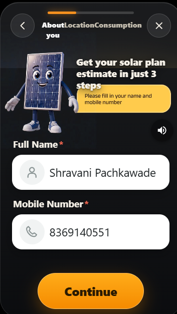
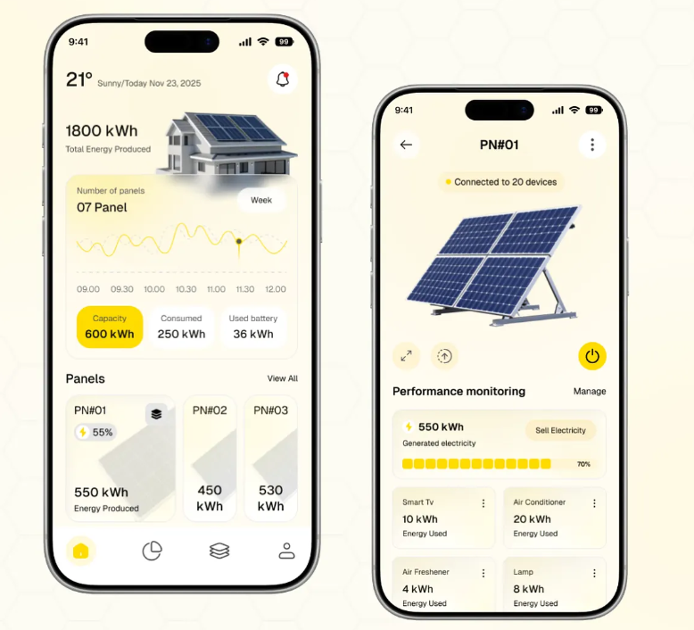
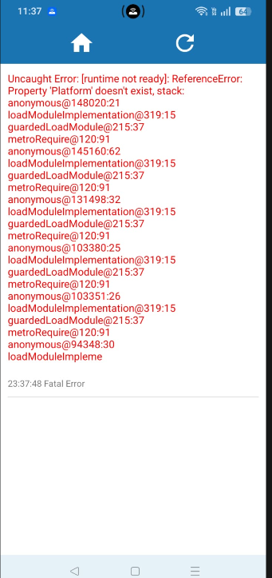
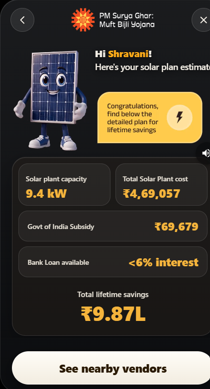
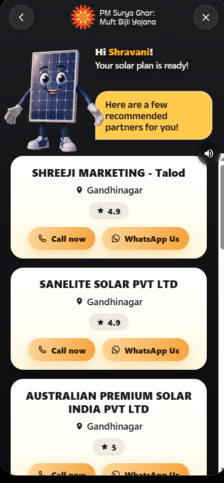

<!-- Slide 1: Title -->
# EcoPulse
## Citizen Carbon Accounting & Rooftop Solar Adoption

A mobile-first platform operationalizing citizen climate action through deterministic emission auditing, micro-nudges, and verified PM Surya Ghar rooftop solar planning.

  

    
<strong>Track:</strong> HC26-GEDA01 (Gujarat Energy Development Agency)

    
<strong>Team:</strong> [TEAM_NAME]

    
<strong>Members:</strong> [MEMBERS]

  

  

    
<strong>Code Repository:</strong> [REPO_URL]

    
<strong>Live Web Demo:</strong> [DEMO_URL]

    
<strong>Video Pitch:</strong> [VIDEO_URL]

  

---

<!-- Slide 2: Problem -->
# The Problem
## The Gap Between Climate Awareness & Daily Action

Citizens recognize climate urgency but lack personalized, transparent tools to quantify domestic emissions, evaluate solar feasibility, and sustain verifiable lifestyle changes.

  

    <h3>Urban Residents</h3>
    
Unaware of specific electricity and fuel footprints; overwhelmed by complex rooftop solar policies and subsidy paperwork.

  

  

    <h3>Local Communities</h3>
    
Zero localized emissions benchmarks, peer comparison, or collective mechanisms to celebrate neighbourhood climate leadership.

  

  

    <h3>State Administrators</h3>
    
Lack verifiable, bottom-up citizen adoption data across Gujarat districts to monitor Mission LiFE targets effectively.

  

Focus: Track HC26-GEDA01 — Empowering Gujarat households with transparent sustainability tools.

---

<!-- Slide 3: Solution -->
# The Solution
## Four Core Capabilities for Citizen Climate Action

EcoPulse bridges awareness and impact through verifiable math, habit reinforcement, and end-to-end solar onboarding.

  

    

      <h3 style="margin: 0;">1. Footprint Tracker</h3>
      Built
    

    
Deterministic calculator covering electricity, cooking gas (LPG/PNG), and multi-modal transport with local Gujarat benchmarks.

  

  

    

      <h3 style="margin: 0;">2. Action Center & Micro-Nudges</h3>
      Built
    

    
14 categorized Mission LiFE habits (Energy, Water, Waste, Mobility, Food) with daily check-ins and append-only points ledger.

  

  

    

      <h3 style="margin: 0;">3. PM Surya Ghar Solar Hub</h3>
      Built
    

    
3-step solar ROI wizard, DISCOM tariff inversion, official subsidy breakdown, and verified Gujarat installer directory.

  

  

    

      <h3 style="margin: 0;">4. Community & Admin View</h3>
      Planned
    

    
Society leaderboards and GEDA administrative analytics for district solar adoption tracking (schema & transactions built).

  

---

<!-- Slide 4: Product Walkthrough -->
# Product Walkthrough
## Mobile-First, Tri-Lingual & Verifiable Interface

Designed for high accessibility across Gujarat with instant preview, audio guidance, and clear status badges.

  

    

      <strong>Onboarding Baseline</strong>  4-step household emissions survey
'" />
    

    
1. Household Baseline

  

  

    

      <strong>Home Dashboard</strong>  CO2 footprint & active habits
'" />
    

    
2. Impact Dashboard

  

  

    

      <strong>Activity Nudge</strong>  Daily streak & point rewards
'" />
    

    
3. Daily Micro-Nudge

  

  

    

      <strong>Solar Feasibility</strong>  Tactile sliders & subsidy ROI
'" />
    

    
4. Solar Estimator

  

  

    

      <strong>Vendor Directory</strong>  Direct Call & WhatsApp
'" />
    

    
5. Verified Installers

  

Tri-lingual (English, Gujarati, Hindi) | Status Badges: Measured, Reported, Estimated

---

<!-- Slide 5: System Architecture -->
# System Architecture
## Mirrored Deterministic Engine & Resilient API

Dual-engine architecture delivers zero-latency client calculation while enforcing authoritative server-side persistence.

  

    
  

  

    <h3 style="color: #10B981; margin-bottom: 10px;">Numbered Request Lifecycle</h3>
    <ol style="font-size: 16px; line-height: 1.45; padding-left: 20px;">
      <li><strong>Client Preview:</strong> Local pure engine computes instant preview with zero network round-trip.</li>
      <li><strong>Authenticated Request:</strong> Client dispatches payload with JWT Bearer token to Express REST API.</li>
      <li><strong>Security & Throttle:</strong> Auth middleware verifies token; rate-limiter prevents denial-of-service.</li>
      <li><strong>Authoritative Calculation:</strong> Server recomputes metrics using identical synced engine code.</li>
      <li><strong>Immutable Persistence:</strong> Snapshot saved to MongoDB Atlas (`FootprintLog` / `SolarEstimate`).</li>
      <li><strong>Verified Response:</strong> Authoritative verdict and subsidy breakdown returned to client.</li>
    </ol>
  

---

<!-- Slide 6: Calculation Engine & Standards -->
# Calculation Engine & Standards
## Verifiable Climate Accounting Across 24/24 Automated Tests

Zero inline magic numbers; all factors are loaded from versioned datasets and verified against government guidelines.

  

    <h3>Core Scientific Standards</h3>
    <ul style="font-size: 15px; line-height: 1.4; padding-left: 18px; margin: 0;">
      <li><strong>Grid Emission Factor:</strong> 0.71 kg CO₂e/kWh Verified CEA CO₂ Baseline Database Ver 19 (2024), Western Grid</li>
      <li><strong>Cooking Fuel:</strong> LPG 2.98 kg/kg, PNG 2.15 kg/SCM Verified IPCC 2006 Guidelines & PPAC Benchmark</li>
      <li><strong>Rooftop Yield:</strong> 33 Gujarat Districts Verified European Commission JRC PVGIS-SARAH2 API v5.2</li>
      <li><strong>DISCOM Tariffs:</strong> UGVCL, DGVCL, MGVCL, PGVCL, Torrent Verified GERC Tariff Orders FY 2024-25 RGP & GUVNL FPPPA</li>
      <li><strong>Central Subsidy:</strong> ₹30k/kW (1-2kW), ₹78k cap Verified MNRE PM Surya Ghar Operational Guidelines (2024)</li>
    </ul>
  

  

    <h3>Engine Integrity & Verification</h3>
    
<strong>Engine Sync Verification:</strong> `scripts/checkEngineSync.js` guarantees byte-for-byte identity between `shared/engine/` and `client/src/engine/`.

    

      
Automated Test Suite: 24/24 PASS

      
Validates subsidy slabs, 25-year degradation (0.5%/yr), bisection bill inversion, and district yield data.

    

    

      Estimate <em>Capital Cost (₹50k-60k/kW) & State Top-up Subsidy pending GEDA tender discovery.</em>
    

  

---

<!-- Slide 7: Database Schema -->
# Database Schema
## Relational Integrity with Append-Only Audit Trails

MongoDB schemas enforce strict foreign-key referencing, compound index constraints, and immutable records.

  

    
  

  

    

      <h3 style="color: #10B981;">Append-Only Points Ledger</h3>
      
`GreenPointTransaction` records are strictly append-only with compound unique index `{ activityCycleId: 1, transactionType: 1 }`, guaranteeing an auditable paper trail and preventing duplicate payouts.

    

    

      <h3 style="color: #10B981;">Immutable Baseline Snapshot</h3>
      
`FootprintLog` captures an immutable `rawInputsSnapshot` at onboarding, ensuring historical carbon reductions and audit comparisons remain mathematically uncompromised.

    

  

---

<!-- Slide 8: Tech Stack -->
# Tech Stack
## Selected from Repository Dependency Manifests

Modern, lightweight stack prioritizing offline reliability, high developer velocity, and unified JavaScript syntax.

| Layer | Technology | Repository Source & Package Reason |
| :--- | :--- | :--- |
| **Mobile Client** | **React Native 0.88 / Expo 58** | `client/package.json` — Rapid cross-platform native compilation and sensor access |
| **Web Preview** | **React Native Web 0.21** | `client/package.json` — Zero-duplication browser rendering for evaluator access |
| **Client Cache** | **@tanstack/react-query 5.105** | `client/package.json` — Resilient query caching, auto-retry, and offline fallback |
| **Backend API** | **Node.js 20 / Express 4.19** | `server/package.json` — High-concurrency event-driven I/O with unified JS calculation |
| **Database** | **MongoDB Atlas / Mongoose 8.4** | `server/package.json` — Flexible nested survey schemas and multikey district indexing |
| **Authentication**| **JWT / bcryptjs 2.4** | `server/package.json` — Stateless, mobile-friendly authorization via bearer tokens |
| **Verification** | **Node.js Assert & Sync Scripts** | `tests/solar.test.js` — Zero-dependency deterministic verification suite |

---

<!-- Slide 9: Value & Scalability -->
# Value & Scalability
## Tangible Citizen Impact with High-Throughput Architecture

Connecting personal utility savings with state-level decarbonization goals.

  

    <h3>Stakeholder Value</h3>
    <ul style="font-size: 15px; line-height: 1.4; padding-left: 18px; margin: 0;">
      <li><strong>Citizens:</strong> ₹78,000 subsidy clarity, &lt;6% green loans, and up to ₹9.87L lifetime electricity bill savings.</li>
      <li><strong>Communities:</strong> Shared accountability for Mission LiFE pledges across housing societies.</li>
      <li><strong>GEDA (Planned):</strong> Aggregated district-level solar adoption metrics and empanelled vendor load visibility.</li>
    </ul>
  

  

    <h3>Implemented Scalability (in Code)</h3>
    <ul style="font-size: 15px; line-height: 1.4; padding-left: 18px; margin: 0;">
      <li><strong>Stateless API:</strong> JWT bearer authentication allows horizontal Node.js clustering without session stickiness.</li>
      <li><strong>Offloaded Client Compute:</strong> Dual pure engine computes previews on device, slashing backend CPU load.</li>
      <li><strong>Compound Indexing:</strong> MongoDB indexes on `{ userId: 1, createdAt: -1 }` and `{ district: 1 }` ensure sub-10ms queries.</li>
    </ul>
  

  
<strong style="color: #10B981;">Scaling Path (Planned):</strong> Redis caching for static district solar yield matrices; read-replicas for administrative analytics; queue-backed push notifications via BullMQ.

---

<!-- Slide 10: Limitations & Roadmap -->
# Limitations & Roadmap
## Transparent Engineering Constraints & Delivery Milestones

Grounded in actual repository code; milestones prioritize data authority and state-level rollouts.

  

    <h3 style="color: #F87171;">Current Limitations (in Repo)</h3>
    <ul style="font-size: 14px; line-height: 1.4; padding-left: 16px; margin: 0;">
      <li><strong>Self-Reported Inputs:</strong> Relies on user bill inputs without direct DISCOM smart-meter API linkage.</li>
      <li><strong>Seasonal Normalization:</strong> Baseline comparison lacks weather/temperature normalization.</li>
      <li><strong>Single Grid Factor:</strong> Uses regional average (0.71 kg/kWh) rather than hourly marginal carbon intensity.</li>
      <li><strong>Cost Discovery:</strong> Solar EPC pricing uses benchmark estimates pending official GEDA tender discovery.</li>
      <li><strong>Partial Translation:</strong> English complete; Gujarati and Hindi localized in core UI keys.</li>
    </ul>
  

  

    <h3 style="color: #10B981;">Phased Engineering Roadmap</h3>
    

      
<strong>Next 2 Weeks (Polish):</strong> Confirm GEDA state top-up subsidy; verify vendor EPC price bands; finalize 100% Gujarati translation strings.

      
<strong>Next 3 Months (Expansion):</strong> Deliver GEDA Administrative Portal with district analytics; deploy society leaderboard challenges.

      
<strong>Next 12 Months (Integration):</strong> Integrate GUVNL DISCOM automated bill sync and dynamic time-of-day grid emission signals.

    

  

